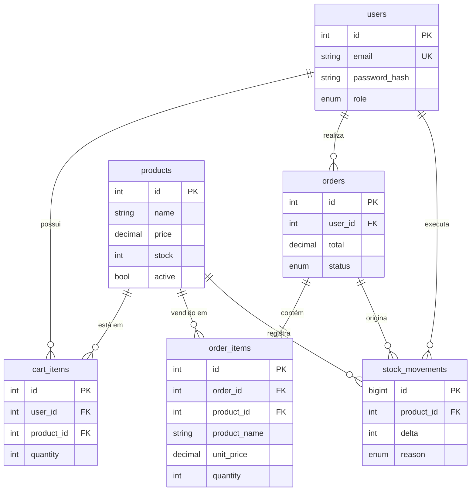

# Loja PHP — E-commerce básico

E-commerce simples desenvolvido em **PHP** (sem frameworks) com **MySQL** para persistência. O projeto implementa **gerenciamento de contas (login)**, **carrinho de compras** e **controle de estoque**, incluindo um painel administrativo.

## Funcionalidades

**Clientes**
- Cadastro, login e logout (senhas com `password_hash`, sessão regenerada no login).
- Catálogo de produtos com busca e indicação de disponibilidade (em estoque, poucas unidades, esgotado).
- Carrinho persistido no banco: adicionar, alterar quantidade, remover e esvaziar, sempre validando o estoque.
- Finalização de compra (checkout) transacional: cria o pedido, registra os itens com o preço da época e **dá baixa no estoque**.
- Histórico de pedidos.

**Administrador**
- Resumo com indicadores (produtos ativos, esgotados, pedidos pendentes, faturamento) e alerta de estoque baixo.
- Cadastro, edição e ocultação de produtos.
- Controle de estoque: entradas e saídas manuais, com **histórico de movimentações** (inicial, reposição, ajuste, venda, cancelamento).
- Gestão de pedidos: alteração de status; ao **cancelar, os itens voltam ao estoque**.

## Tecnologias

- PHP 8.1+ (extensões `pdo_mysql` e `mbstring`)
- MySQL 8+ ou MariaDB 10.4+
- HTML + CSS puro (sem dependências externas)

## Como executar

### 1. Clonar o repositório

```bash
git clone https://github.com/SEU-USUARIO/NOME-DO-REPOSITORIO.git
cd NOME-DO-REPOSITORIO
```

### 2. Criar o banco de dados

Pelo terminal:

```bash
mysql -u root -p < database/schema.sql
mysql -u root -p < database/seed.sql
```

Ou pelo phpMyAdmin: importe `database/schema.sql` e, em seguida, `database/seed.sql`.

> O `seed.sql` deve ser executado **uma única vez** (ele cria as contas e produtos de exemplo).

### 3. Configurar a conexão

Copie o arquivo de exemplo e ajuste usuário e senha do seu MySQL:

```bash
cp config/config.local.example.php config/config.local.php
```

Alternativamente, use variáveis de ambiente: `DB_HOST`, `DB_PORT`, `DB_NAME`, `DB_USER`, `DB_PASS`.

### 4. Iniciar o servidor

```bash
php -S localhost:8000 -t public
```

Acesse <http://localhost:8000>.

> **Usando XAMPP/Apache?** Aponte o *DocumentRoot* para a pasta `public/`. Se preferir colocar o projeto em `htdocs/`, defina `base_path` (por exemplo, `/ecommerce-php/public`) em `config/config.local.php`.

Se alguma página mostrar "erro inesperado", os detalhes ficam no log do PHP (no terminal onde o `php -S` está rodando).

## Contas de exemplo

| Perfil  | E-mail             | Senha        |
|---------|--------------------|--------------|
| Admin   | `admin@loja.com`   | `admin123`   |
| Cliente | `cliente@loja.com` | `cliente123` |

São apenas dados de demonstração — troque as senhas antes de qualquer uso real.

## Estrutura do projeto

```
├── config/
│   ├── config.php                # configuração padrão (lê variáveis de ambiente)
│   └── config.local.example.php  # modelo para credenciais locais
├── database/
│   ├── schema.sql                # criação do banco e das tabelas
│   └── seed.sql                  # contas e produtos de exemplo
├── public/                       # única pasta exposta ao navegador
│   ├── index.php                 # catálogo
│   ├── login.php / register.php / logout.php
│   ├── cart.php / checkout.php / orders.php
│   ├── admin/                    # painel administrativo
│   └── assets/style.css
└── src/
    ├── bootstrap.php             # sessão, configuração e carregamento
    ├── db.php                    # conexão PDO
    ├── auth.php                  # login, permissões e CSRF
    ├── shop.php                  # regras de negócio: carrinho, checkout, pedidos, estoque
    ├── helpers.php               # utilitários (escape, dinheiro, URLs…)
    └── views/                    # cabeçalho e rodapé
```

## Modelo de dados



## Decisões técnicas e segurança

- **SQL Injection:** todas as consultas usam *prepared statements* (PDO com `ATTR_EMULATE_PREPARES = false`).
- **XSS:** toda saída HTML passa por `htmlspecialchars` (função `e()`).
- **CSRF:** todo formulário `POST` carrega um token verificado no servidor (inclusive o logout).
- **Senhas:** `password_hash`/`password_verify` (bcrypt) com reaproveitamento automático de hash se o algoritmo for atualizado.
- **Sessão:** cookie `HttpOnly` + `SameSite=Lax` e `session_regenerate_id` no login/logout.
- **Redirecionamentos:** apenas para caminhos internos (evita *open redirect*).
- **Estoque consistente:** o checkout roda em transação, com `SELECT … FOR UPDATE` nas linhas envolvidas e `UPDATE … WHERE stock >= ?`, impedindo vender além do estoque mesmo com compras simultâneas.
- **Valores monetários:** `DECIMAL(10,2)` no banco e cálculos em centavos inteiros no PHP (sem erros de ponto flutuante).
- **Histórico preservado:** itens de pedido guardam nome e preço da época; produtos com vendas são ocultados em vez de apagados.

## Roteiro de teste manual

1. Cadastre uma conta (ou entre como cliente) e adicione produtos ao carrinho.
2. Tente adicionar mais unidades do que o estoque (ex.: a *Luminária de Mesa LED* tem 3) — deve ser bloqueado.
3. Finalize a compra e confira o pedido em **Meus pedidos** e o estoque reduzido no catálogo.
4. Entre como admin: cadastre um produto, registre uma reposição em **Estoque** e veja o histórico.
5. Em **Pedidos**, cancele o pedido e confirme que o estoque foi devolvido.

## Limitações e próximos passos

Projeto didático, sem integração de pagamento, cálculo de frete, recuperação de senha ou limitação de tentativas de login. Ideias de evolução: paginação, upload de imagens, categorias, e-mail de confirmação, testes automatizados e *rate limiting* no login.

## Autor

Projeto individual desenvolvido por **SEU NOME**.
